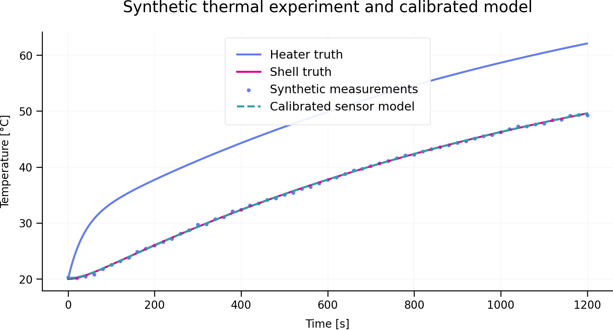

# CrediTwin-Aero

**A risk-informed digital-twin and model-credibility framework for an inert aerospace thermal test article.**

> **Status: v0.1.0, development only.** The current evidence is generated from synthetic data. This release verifies implementation behaviour; it does not experimentally validate the model.



## Why this project exists

A polished simulation is not automatically a credible digital twin. Engineering use requires a declared context of use, traceable data, explicit assumptions, verification evidence, uncertainty and a clear statement of what the model cannot support.

CrediTwin-Aero builds those practices into the repository itself. The current release implements an interpretable reduced-order thermal model in independent Python and C++17 code, synthetic sensing, parameter calibration, Monte Carlo uncertainty propagation, energy accounting, automated tests and evidence reports. The planned physical counterpart is a benign, low-voltage, electrically heated cylindrical article.

The project deliberately excludes energetic materials, combustion, internal ballistics, flight performance, guidance and weapon-effect modelling.

## Research question

> To what extent can an uncertainty-aware reduced-order model estimate the internal thermal state and a future structural decision metric of an inert cylindrical aerospace test article using sparse, noisy surface measurements?

Three contexts of use drive the credibility argument:

1. **COU-1, visualisation:** display estimated temperatures.
2. **COU-2, test monitoring:** provide advisory thermal-threshold warnings.
3. **COU-3, engineering decision support:** estimate a simplified thermal-structural margin.

Only COU-1 is represented in v0.1.0. The stronger uses remain disabled until stronger evidence exists.

## v0.1.0 results

The reproducible baseline uses a 1,200 s synthetic experiment, a 0.5 s RK4 step and a constant 40 W input.

| Check | Result |
|---|---:|
| Python unit tests | 3 passed |
| C++ unit executable | passed |
| Maximum energy-balance residual | 0.000603 J |
| Zero-input equilibrium error | 0 K |
| Maximum Python/C++ state difference | 5.00e-10 K |
| Synthetic-sensor calibration RMSE | 0.1565 K |
| Monte Carlo samples | 300 |
| Final sensor-temperature 90% interval | 322.08–325.78 K |

The calibration does not recover every hidden synthetic parameter exactly. This is intentional and useful: a single surface-temperature channel cannot, by itself, guarantee unique separation of thermal conductance and sensor bias. The repository therefore treats parameter identifiability as an engineering concern rather than hiding it behind a good curve fit.

See [`results/VERIFICATION_REPORT.md`](results/VERIFICATION_REPORT.md) and [`results/verification_report.json`](results/verification_report.json) for generated evidence.

## Model

The reduced-order model contains two thermal masses and a first-order sensor:

```text
Electrical input -> [heater mass] --G_hs--> [shell mass] --G_sa--> ambient
                                             |
                                             +--> first-order sensor
```

For node `i`:

```text
C_i dT_i/dt = sum_j G_ij (T_j - T_i) + Q_i - Q_loss,i
```

The current external loss is linearised as `G_sa(T_shell - T_ambient)`. This keeps the baseline transparent and fast, but it does not resolve spatial gradients, separate convection from radiation, or account for temperature-dependent properties. Those limitations are recorded in [`credibility/assumptions-register.yaml`](credibility/assumptions-register.yaml).

## Architecture

```text
Physical/synthetic source
          |
          v
Versioned observations --> quality checks --> immutable run data
          |                                      |
          v                                      v
C++/Python thermal model <--> calibration and uncertainty
          |                                      |
          +--------------> evidence ledger <-----+
                                |
                                v
                 context-specific decision output
```

The C++ and Python implementations are currently independent. This provides a cross-implementation comparison instead of making one implementation a wrapper around the other.

## Repository map

```text
cpp/                 C++17 model, CLI and tests
python/creditwin/    Python reference model, calibration, UQ and reporting
configs/             Versioned model configurations
data/synthetic/      Reproducible synthetic observations
requirements/        System/model requirements and evidence links
credibility/         Context of use and assumptions register
docs/                Theory, research basis, scope and safety
results/             Generated plots and evidence reports
tests/               Python verification tests
.github/workflows/   Continuous integration
```

## Quick start

### Python

```bash
python -m venv .venv
source .venv/bin/activate
python -m pip install -e .
python -m unittest discover -s tests -v
creditwin verify --root .
```

### C++ with CMake

```bash
cmake -S . -B build -DCMAKE_BUILD_TYPE=Release
cmake --build build --parallel
ctest --test-dir build --output-on-failure
./build/creditwin_sim results/cpp_baseline.csv
```

If CMake is unavailable, a direct GNU C++ build is sufficient for the tests:

```bash
g++ -std=c++17 -O2 -Wall -Wextra -Wpedantic -Icpp/include \
  cpp/src/thermal_model.cpp cpp/tests/test_thermal.cpp \
  -o creditwin_cpp_tests
./creditwin_cpp_tests
```

## Reproducibility

- Random generators use fixed seeds.
- Generated observations are explicitly marked synthetic.
- SI units are used internally.
- Reports record model configuration and execution environment.
- Raw observations and model results are separate artefacts.
- CI builds both implementations and regenerates the report.

Run the complete local workflow with:

```bash
./scripts/run_all.sh
```

## Evidence maturity

| Area | v0.1.0 status |
|---|---|
| Software tests | Implemented |
| Energy accounting | Implemented |
| Python/C++ parity | Implemented |
| Synthetic calibration | Implemented |
| Uncertainty propagation | Implemented |
| Numerical refinement study | Planned |
| Parameter-identifiability analysis | Partial |
| Independent validation dataset | Planned |
| Physical test article | Planned |
| Experimental validation | Not claimed |
| Thermal-structural decision model | Planned |

## Roadmap

- **v0.2:** numerical refinement, analytical limiting-case report and formal input schemas.
- **v0.3:** experiment protocol, DAQ ingestion, immutable raw-data manifest and sensor calibration records.
- **v0.4:** offline axisymmetric reference model and multifidelity comparison.
- **v0.5:** blind experimental validation, residual monitoring and applicability checks.
- **v1.0:** physical digital-twin demonstration with context-specific credibility reports.

No version will claim more maturity than its evidence supports.

## Safety and responsible scope

This is an educational research demonstrator, not operational aerospace software. It is not flight-qualified, safety-certified or suitable as a protective control. A future physical build must use independent electrical and thermal protection and an approved laboratory risk assessment. Read [`docs/safety-and-scope.md`](docs/safety-and-scope.md) before extending the hardware interface.

## Research basis

The architecture is informed by aerospace digital-twin literature, model-and-simulation credibility guidance, and digital-thread concepts. Full references and the boundary on how propulsion literature is used are in [`docs/references.md`](docs/references.md). Source papers are not redistributed.

## Licence and citation

Code is released under the MIT Licence. Citation metadata is provided in [`CITATION.cff`](CITATION.cff).
